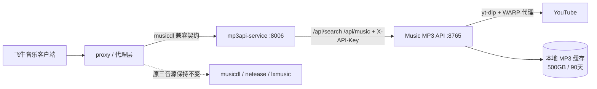

# 第四音源：Music MP3 API（`mp3api`）接入说明

本文说明本次改动如何把自建的 **Music MP3 API** 接入 `fnos_music_ext`，使其成为与
`musicdl` / `netease` / `lxmusic` 并列的**第四类主音源**。

> 适用范围：基于 `javycoder/fnos_music_ext` v3.1.2 的改动版本。
> 该音源默认关闭，不影响原有三音源的任何行为。

---

## 1. 背景与目标

`fnos_music_ext` 的代理层（`proxy/app.py`）内部把在线音源分成三条分支：
`netease`、`lx`（洛雪）、以及兜底的 `musicdl`。搜索结果的 GUID 形如
`online:<source>:<id>`，代理据此决定调用哪个音源服务、如何取链、是否允许 Range、
是否边听边存。

自建的 Music MP3 API 是一个独立项目：以 `yt-dlp` 搜索/下载 YouTube 音视频，
用 `ffmpeg` 转码为 MP3，按 `sha1(video_id|bitrate|codec)` 本地缓存，并提供
`/api/search`、`/api/resolve`、`/api/music` 等接口。它的返回格式与
`fnos_music_ext` 需要的音源契约并不一致，因此不能直接在代理里改 URL 了事。

本次改动的目标：

1. 让飞牛音乐能直接搜索并播放自建 API 里的曲目；
2. **不改动**原有三音源的搜索、取链、Range/206、转码、缓存、封面链路；
3. 上游 API Key 不出现在任何客户端可见的数据里；
4. 上游 API 可部署在同机 NAS、局域网另一台机器，或经 HTTPS 域名远程访问；
5. 默认关闭，升级/重装不会把用户切到新音源。

---

## 2. 架构决策：适配器而非重写分派

代理里有 16 处以上按音源分支的判断（搜索聚合、取链、播放直连、健康诊断、
每日推荐、专辑搜索、搜索建议等）。逐处新增 `mp3api` 分支风险高、回归面大。

采用的做法是**兼容 `musicdl` 的 HTTP 契约**：新增独立服务 `mp3api-service/`，
把上游 Music MP3 API 包装成代理已经认识的 `/healthz`、`/sources`、`/search`、
`/info`、`/stream` 五个端点；条目标记为 `mp3api:<video_id>`，GUID 变成
`online:mp3api:<video_id>`。由于前缀既不是 `netease` 也不是 `lx`，代理会自动
落入既有的 musicdl 分支，于是**取链、Range 透传、206、边听边存、封面、转码
全部复用**。

代理只需要一处改动：`get_musicdl_client()` 在 `FNMUSIC_MP3API_ENABLED=true`
时把 `base_url` 从 `FNMUSIC_MUSICDL_URL` 切到 `FNMUSIC_MP3API_URL`，并把超时
从 45s 放宽到 300s（首次下载需要 yt-dlp + ffmpeg，耗时较长）。切换时会检测
`base_url` 变化并重建 `httpx.AsyncClient`，因此运行期切源立即生效。



---

## 3. 服务契约

`mp3api-service` 监听容器 `8006`（宿主 `127.0.0.1:8776`），实现：

| 端点 | 说明 |
| :--- | :--- |
| `GET /healthz` | 返回服务状态与上游 `upstream_status`，供 WebUI / healthcheck / extend 验收 |
| `GET /sources` | 返回 `[{"id":"mp3api", ...}]`，供安装接管流程识别音源 |
| `GET /search?keyword=&limit=` | 调上游 `/api/search`，映射为代理期望的条目结构，id 为 `mp3api:<video_id>` |
| `GET /info?id=mp3api:<video_id>` | 调上游 `/api/resolve`，返回标题、作者、时长、封面等元数据 |
| `GET /stream?id=...&proxy=true[&quality=mp3]` | 调上游 `/api/music` 并**流式透传**，支持 `Range` → `206 + Content-Range` |

刻意**不实现** `/internal/resolve` 与 `/internal/stream`：这两个端点会把上游地址
暴露给客户端，与「API Key 只在服务端」的安全约定冲突。因此使用本音源时
**播放直连必须关闭**（`FNMUSIC_MUSICDL_DIRECT_PLAY=false`），播放一律经代理取流。

id 解析规则：接受 `mp3api:<vid>`、`online:mp3api:<vid>`、裸 `<vid>` 三种形式，
并用 `^[A-Za-z0-9_-]{11}$` 校验 YouTube video_id，防止拼接出非法上游请求。

---

## 4. 安全设计

| 风险 | 处理 |
| :--- | :--- |
| API Key 泄漏给客户端 | Key 只从服务端环境变量 / `.env` 读取，仅放进请求上游的 `X-API-Key` 头；不写入搜索结果、`info`、302 `Location`、日志 |
| 上游地址暴露 | 不实现 `/internal/*`；要求直连关闭 |
| 密钥扩散到同容器其他进程 | `container/env_flag.sh` 的 `export_source_env()` 只导出固定白名单，不认识 `MP3API_*`；若把密钥写进 supervisor `environment`，会被容器内所有子进程继承。因此改为让 `mp3api-service/app.py` 自行只读加载 `.env` |
| 重装被清空 | `MP3API_API_KEY` 未加入 `ENV_EXPLICIT`，安装脚本合并 `.env` 时不会覆盖用户在管理页保存的密钥 |
| 上游返回超长 / 超大资源 | `MP3API_MAX_DURATION`（默认 900s）在**搜索阶段**过滤；错误响应体按 UTF-8 解码，避免乱码 |
| 非法 id / SSRF | video_id 白名单校验；上游地址由服务端配置，不接受客户端传入 URL |
| 远程访问 | 上游可经 `https://mp3.994938.xyz` + Nginx 反代 + 独立证书访问，密钥不落前端 |

`.env` 加载规则：`FNMUSIC_ENV_FILE`（Docker 为 `/repo/.env`，native 为渲染后的
仓库 `.env`）→ 只读解析 `MP3API_*` → **已存在的环境变量优先**（compose /
supervisord / CI 显式注入优先于文件）→ `MP3API_NO_DOTENV=1` 可完全关闭文件加载。

---

## 5. 配置清单

### 代理侧（`FNMUSIC_*`）

| 变量 | 默认 | 说明 |
| :--- | :--- | :--- |
| `FNMUSIC_MP3API_ENABLED` | `false` | 第四音源开关，与其他三音源互斥单选 |
| `FNMUSIC_MP3API_URL` | `http://127.0.0.1:8776` | 代理访问适配器的地址（Docker 形态为容器内地址） |
| `FNMUSIC_ONLINE_SOURCES` | 空 | **必须置空**，否则在线音源白名单会过滤掉 `mp3api` 条目 |
| `FNMUSIC_MUSICDL_DIRECT_PLAY` | `false` | **必须关闭**，适配器不暴露上游直连地址 |
| `WEBUI_MP3API_URL` | `http://127.0.0.1:8006` | WebUI 健康检查地址（native 形态渲染为 `8776`） |

### 适配器侧（`MP3API_*`）

| 变量 | 默认 | 说明 |
| :--- | :--- | :--- |
| `MP3API_BASE_URL` | `http://127.0.0.1:8765` | 上游 Music MP3 API；远程可填 `https://mp3.994938.xyz` |
| `MP3API_API_KEY` | 空 | 上游 API Key，**仅服务端可见** |
| `MP3API_BITRATE` | `192` | 请求码率 kbps（64–320），`quality=mp3` 时上限 128 |
| `MP3API_TIMEOUT` | `300` | 上游请求超时（秒），需容纳首次下载 |
| `MP3API_MAX_DURATION` | `900` | 搜索结果最长时长（秒），`0` 表示不过滤 |
| `MP3API_SOURCE_NAME` | `mp3api` | 条目 id 前缀 / `/sources` 名称 |
| `MP3API_TRUST_ENV` | `0` | 是否继承进程环境代理 |
| `MP3API_LOG_LEVEL` | `INFO` | 日志级别 |
| `MP3API_NO_DOTENV` | 未设置 | 设为 `1` 禁用 `.env` 加载 |

> 上游 Music MP3 API 需单独部署，本仓库只包含适配器，不包含上游源码。

---

## 6. 部署编排

| 形态 | 落地方式 |
| :--- | :--- |
| Docker Compose | 新增 `127.0.0.1:8776:8006` 端口映射；`.dockerignore` 白名单放行 `!mp3api-service/`；`Dockerfile` COPY 其 `requirements.txt` 与 `app.py`，`EXPOSE` 增加 `8006` |
| supervisord（容器） | 新增 `[program:mp3api]`，`directory=/srv/mp3api-service`，`uvicorn app:app --host 0.0.0.0 --port 8006` |
| supervisord（native） | 新增 `[program:mp3api]` 监听 `127.0.0.1:8776`，并给 WebUI 注入 `WEBUI_MP3API_URL` |
| 进程选择 | `entrypoint.sh` 的「四选一」分支新增 `FNMUSIC_MP3API_ENABLED -> start_prog mp3api` |
| 健康检查 | `healthcheck.sh` 新增 `check mp3api FNMUSIC_MP3API_ENABLED`；上游可达性由 `/healthz` 的 `upstream_status` 反映 |
| native 依赖 | `ensure_sources_native.sh` 的 `REQ_FILES` 加入适配器 requirements |
| 安装脚本 | `install.sh` 支持 `--sources mp3api`、向导第 4 项、`ENV_DESIRED` / `ENV_EXPLICIT`、`SELECTED` 端口显示、安装后 healthz 等待 |
| 接管脚本 | `extend.sh` 的启用判定与 `wait_source` 支持第四音源 |
| FPK 安装包 | 向导增加第 4 个选项，`cmd/install_callback` 白名单放行 `mp3api`（否则会被回退成 musicdl），`build.sh` 的 rsync 全量携带新目录 |

### 启用命令

```bash
./install.sh --non-interactive --sources mp3api --webui --extend
```

或在飞牛应用中心向导选择 **mp3api**，装好后在管理页
「音乐源 → Music MP3 API」填写 `MP3API_BASE_URL` 与 `MP3API_API_KEY`，
保持播放直连关闭即可。

---

## 7. 验证结果

| 项目 | 结果 |
| :--- | :--- |
| `bash -n`（install / extend / entrypoint / healthcheck / env_flag） | 通过 |
| `py_compile`（app / proxy / webui / runner） | 通过 |
| `git diff --check`、compose YAML、supervisord 6 个 program | 通过 |
| `mp3api-service` 离线契约测试 | **11 passed** |
| 回归合计（适配器 + 容器编排 + runner 同步性） | **54 passed** |
| `.env` 加载三态（加载 / 显式优先 / 关闭） | 通过 |
| 真实链路冒烟 | 上游 8765 与适配器 8776 在线；`/search` 返回 `mp3api:-PaYq5Pt228`；`/stream` 返回 `206 + Content-Range: bytes 0-1023/6427052`，MP3 字节流正常 |

已知环境限制（**非本次改动引入**，已用上游 HEAD 原始版本对照确认）：
Windows git-bash 下个别测试因中文输出 GBK 被 UTF-8 解码报 `UnicodeDecodeError`，
`install.sh` 抽查块在 HEAD 下同样报 `unexpected EOF`；runner 并发时序测试偶发
flaky（单独复跑通过）。完整 `python scripts/run_tests.py` 建议在 Linux / CI 复跑。

---

## 8. 兼容性

- 默认 `FNMUSIC_MP3API_ENABLED=false`，`get_musicdl_client()` 仍指向原 musicdl，
  **原三音源行为零变化**。
- 第四音源与其余三个互斥单选，沿用项目 v2.0.0 起的单选规则；WebUI 校验文案
  与安装脚本互斥校验已同步为「四选一」。
- 原 `proxy` / `webui` 的「三选一」文案、进程映射、健康映射、测试断言已全部同步。
- 若上游 API 不可达，`/healthz` 会如实反映 `upstream_status`，不会把整条链路
  伪装成健康；搜索阶段上游 502 做软失败，不拖垮聚合搜索。

---

## 9. 合规声明

本音源仅用于**拥有版权或已获授权的内容**，以及个人 / 家庭自用的学习场景。
请勿用于公开分发、商业用途或绕过平台方的访问限制。YouTube 相关内容的下载
行为需遵守平台服务条款与所在地法律法规；飞牛音乐扩展与本项目均不提供、
也不保证任何第三方平台的会员或付费内容权限。
